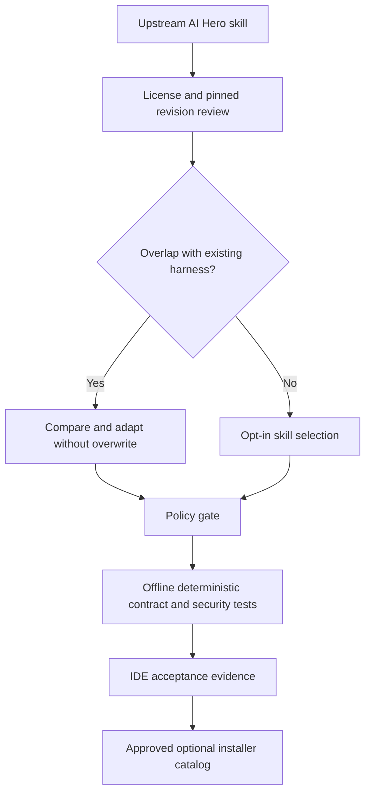

# AI Hero / Matt Pocock Skills — Candidate Integration Review

**Status:** research-only; no external skills installed, downloaded, executed, or enabled.
**Source:** https://www.aihero.dev/skills and https://github.com/mattpocock/skills (reviewed 2026-10-22).
**Scope:** 27 published upstream skills, grouped into six workflows. The upstream installation command is `npx skills@latest add mattpocock/skills`, but the harness must not execute it automatically.

## Fit and priority

| Upstream skill | Harness decision | Reason |
| --- | --- | --- |
| `grill-me`, `grill-with-docs`, `handoff` | Already covered; compare, do not overwrite | Existing native `grill-me`, `grill-with-docs`, `session-handoff` |
| `to-spec`, `to-tickets` | Evaluate mapping | Spec Kit owns planning; do not introduce competing specs or issue authority |
| `implement`, `implement-spec` | Deferred | Implementation, commits, worktrees and parallel subagents need explicit permissions, policy gate and deterministic verification |
| `code-review` | High-priority candidate | Independent standards-vs-spec review complements harness verification, but does not replace it |
| `retro` | High-priority candidate | Turn observed failures into proposed improvements with human review |
| `diagnosing-bugs` | High-priority candidate | Repro-first investigation; compare with curated systematic debugging |
| `improve-codebase-architecture` | High-priority candidate | Read-only architecture health reports and scoped refactoring proposals |
| `writing-for-agents` | High-priority candidate | Improve clarity and token footprint of harness instructions |
| `prototype`, `research`, `wayfinder` | Medium-priority candidates | Bounded exploratory work with evidence and explicit discard/decision outcome |
| `triage`, `wizard`, `to-questionnaire` | Medium-priority candidates | GitHub issue triage and human-facing setup, subject to authorization |
| `pr`, `codebase-design`, `domain-modeling`, `tdd` | Evaluate as reference patterns | Preserve existing PR two-Mermaid convention and harness verification |
| `setup-matt-pocock-skills`, `ask-matt`, `teach`, `wait-what`, `grilling` | Optional / overlapping | Avoid duplicating existing routing, onboarding and interview workflows |

## Proposed safe integration

1. Keep `skills/upstream-sources.json` **reference-only** until a specific upstream commit, license and content review are recorded.
2. Add **selectable** skill candidates only after checking Copilot discovery compatibility, permissions, local dependencies, source provenance, conflicting skill names, and rollback.
3. Never execute `npx`, download third-party code, overwrite existing `SKILL.md` files, or grant GitHub write permissions as a side effect of discovery.
4. Test positive, negative and overlap cases in the selector; separately record actual VS Code / Visual Studio invocation. A CI smoke PASS is not proof of IDE behavior.
5. Preserve Git Flow (feature → develop; release → main; main back-sync) and **exactly two Mermaid diagrams** in PR bodies.

## Suggested implementation sequence

- **Phase A:** read-only review skill candidate (standards vs spec) and regression evaluation.
- **Phase B:** diagnosing-bugs and architecture review candidates, with deterministic evidence contracts.
- **Phase C:** opt-in installer support for reviewed, pinned upstream content, with safe upgrade and rollback.
- **Phase D:** evaluate issue-tracker / Spec Kit integrations; defer multi-agent worktree execution until security and permissions review.

**Decision:** add AI Hero to the candidate registry now; do not claim its 27 skills are installed or supported by the harness.
