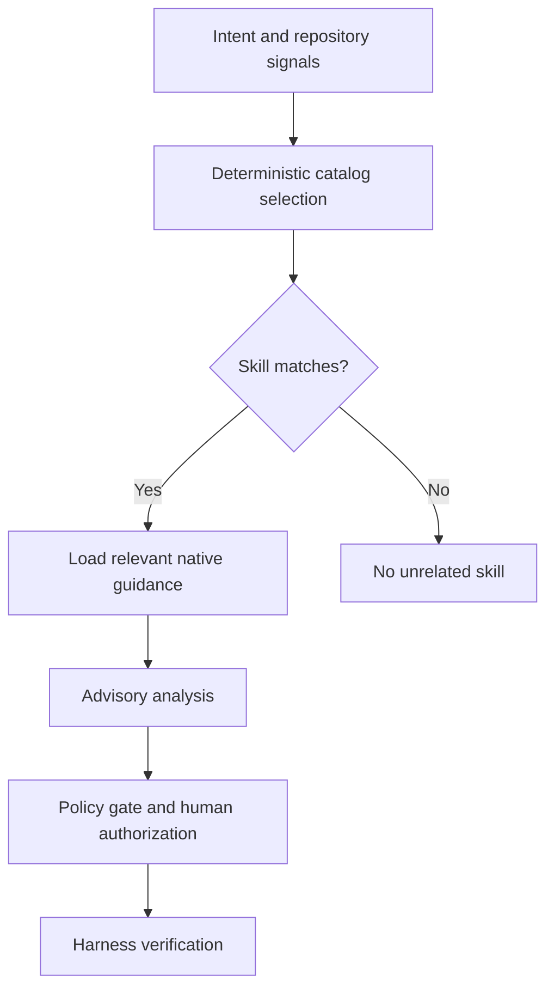

# Curated Skills

The harness uses a curated capability layer rather than installing entire external agent frameworks.

## Sources

Initial patterns are reviewed from:

- GitHub `github/awesome-copilot`
- Superpowers `obra/superpowers`

The catalog records upstream provenance. External projects remain their own source of truth; the harness does not silently copy or auto-update third-party instructions.

## Authority boundaries

Skills are capability guidance, not a parallel control plane.

- Spec Kit owns specification/planning workflow.
- `scripts/policy-check.ps1` owns execution authorization.
- `scripts/verify.ps1` owns deterministic verification evidence.
- CodeGraph provides semantic context.
- Curated skills may guide how Copilot approaches a task, but cannot authorize commands or declare verification success.

## Initial catalog

| Skill | Upstream pattern | Harness role |
| --- | --- | --- |
| systematic-debugging | obra/superpowers | root-cause-first debugging |
| test-driven-development | obra/superpowers | red-green-refactor guidance |
| verification-before-completion | obra/superpowers | mapped to harness verification contract |
| acquire-codebase-knowledge | github/awesome-copilot | repository exploration using existing instructions + CodeGraph |

## Selection

```powershell
.\scripts\skills.ps1 -TargetPath . -Intent "debug failing API test" -ChangeType bug
```

Selection is deterministic from the local catalog, detected stack, and task intent. Skills requiring MCP are excluded from the baseline.

## Why not install everything?

Whole-framework installation would create overlapping authorities for planning, execution, verification, and agent behavior. The harness instead adopts narrowly useful patterns while preserving one policy gate and one verification contract.


## Runtime integration

`scripts/context.ps1` invokes the selector with the effective change type and optional task intent. The context manifest exposes `SelectedSkills` and `SkillRules`, so the normal Context & Evidence Engine can consume capability guidance without a separate manual selection step.

The installer deploys `scripts/skills.ps1`, `skills/catalog.json`, and this contract, and records those assets in the installation manifest.

A selected skill cannot raise the automatic execution ceiling or turn generated guidance into deterministic verification evidence.

**Copilot proposes; the harness verifies.**

## Native skill catalog (v1.1–v1.2)

The original curated patterns above remain catalog capabilities. The repository also installs native `SKILL.md` guidance for:

| Native skill | Intended review |
| --- | --- |
| `code-review` | Evidence-grounded cross-stack PR review, severity P0–P3, specification coverage and verification boundaries |
| `grill-me` | Clarify requirements through guided questions |
| `grill-with-docs` | Review requirements against supplied documentation |
| `session-handoff` | Transfer task state with evidence and next steps |
| `aspnet-core-review` | ASP.NET Core architecture and correctness |
| `angular-feature-review` | Angular features, accessibility and maintainability |
| `sql-server-data-review` | SQL Server queries, transactions, indexes and migrations |
| `mongodb-data-review` | MongoDB document models, queries and aggregation |
| `snowflake-data-review` | Snowflake transformations, ingestion and cost-aware review |



Run `pwsh ./tests/native-data-skills-smoke.ps1` and `pwsh ./tests/data-skill-selection-benchmark.ps1` for deterministic coverage. A selected skill does not prove real IDE invocation. Doctor reports optional skill installation separately from the IDE adoption acceptance process.

## Native code-review selection contract

The optional `code-review` native skill is included in deterministic catalog selection only when the task explicitly requests a **code review**, **PR review**, **diff review** or **patch review**. Implementation-only tasks, handoffs and documentation-only changes do not activate it. This guidance is advisory: selecting the skill does not authorize code changes, PR approval, merge, or a passing verification claim.

The `tests/skills-smoke.ps1` regression suite checks positive selection, negative selection and documentation anti-triggers. Real Copilot IDE invocation remains separately unverified.

## Code-review quality benchmark

The human-reviewed rubric in `evals/interaction-response-quality.json` includes six `code-review` cases: ASP.NET Core cross-tenant authorization, Angular untrusted HTML, SQL Server transfer atomicity, MongoDB idempotency races, Snowflake full-table ETL cost risk, and a clean C# rename to check false positives. Each case uses weighted criteria for evidence, scope, mitigation and accurate verification claims.

Run `pwsh ./scripts/eval-interaction-quality.ps1 -Json` to validate the unreviewed rubric. Supply reviewer-scored results with `-ResultsPath` for actual quality assessment. `tests/interaction-quality-smoke.ps1` uses synthetic fixtures to verify scoring mechanics only; it does **not** execute an LLM or prove real Copilot behavior.
