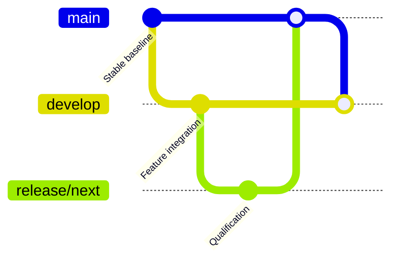

# Git Flow and Releases

## Branch model

- `main`: released, production-ready harness versions only.
- `develop`: integration branch for the next version.
- `feature/*`: created from `develop`, merged back through PRs.
- `release/*`: created from `develop` for stabilization, then merged to `main` and back to `develop`.
- `hotfix/*`: created from `main`, merged to both `main` and `develop`.

## Versioning

Use Semantic Versioning (`MAJOR.MINOR.PATCH`).

- PATCH: fixes or non-breaking instruction/workflow improvements.
- MINOR: new harness capabilities or supported stack modules that remain backwards compatible.
- MAJOR: breaking installer/configuration/workflow changes.

## Release process

1. Create `release/x.y.z` from `develop`.
2. Stabilize documentation, templates, installer behavior, and release notes.
3. Open a PR from `release/x.y.z` to `main` with **two Mermaid diagrams**: technical/change flow and Git Flow position.
4. Merge after validation.
5. Create GitHub release/tag `vx.y.z` from the merged `main` commit.
6. Merge `main` or the release branch back into `develop`.

## Pull request policy

Every pull request must include **exactly two Mermaid diagrams**, including documentation-only work: one technical/change flow and one Git Flow branch-position diagram. See `docs/PR-DIAGRAMS.md`.

## Git Flow overview

The diagram is illustrative, not a claim about exact historical commits. Following promotion, synchronize `main` into `develop` without rewriting history.
