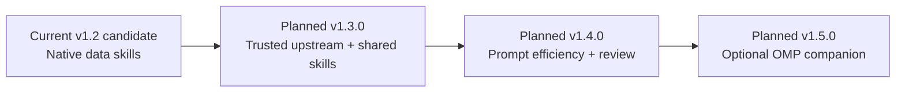
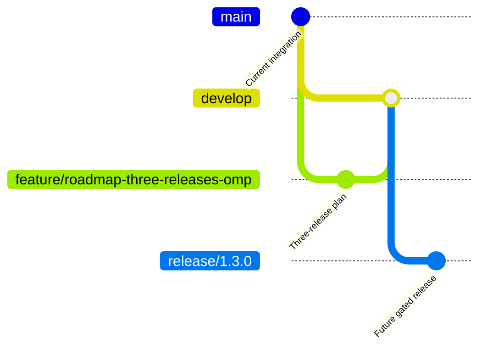

# Post-v1.2 Roadmap — Three Releases, Optional Oh My Pi Companion

> **Status: proposal, not a release commitment.** Planned versions: v1.3.0, v1.4.0, v1.5.0. Individual features require reviewed PRs, deterministic acceptance evidence and the established Git Flow release gates.

## Starting point (2026-10-21)

- Repository `main` currently contains `VERSION=1.2.0`; the latest **published GitHub Release** is v1.1.0. Do not mistake a merged release candidate for a published/qualified release.
- Native Copilot skills, selected-skill benchmarks, the installer/Doctor, A0–A4 policy gate, deterministic verification, maker/checker, and durable evidence already exist.
- `can1357/oh-my-pi` (OMP) is a standalone coding-agent runtime, **not** a GitHub Copilot extension. Its documentation identifies Windows installation, Copilot among model providers, and discovery of project `.github/skills/<name>/SKILL.md` files.
- The team baseline remains GitHub Copilot in VS Code / Visual Studio plus approved CLIs; neither MCPs, marketplace plugins, nor third-party agent installations may be assumed.

## Release sequence

### v1.3.0 — Trusted Upstream and Portable Skills

**Goal:** ensure portable, carefully reviewed skill assets work predictably in the core Copilot workflow and can be reused by other agent runtimes without new baseline dependencies.

**Deliverables**
1. Register `can1357/oh-my-pi` in `skills/upstream-sources.json` as `candidate`, `reference-only`, without remote execution. Verify a specific upstream commit, provenance, license and security properties before promotion.
2. Document the shared `.github/skills/<name>/SKILL.md` discovery intersection; record provider-specific limitations (frontmatter, precedence, subdirectories, tool availability and invocation).
3. Validate existing native skills and installation preservation through fixtures on .NET and Angular, with the SQL Server/MongoDB/Snowflake selection cases where appropriate.
4. Extend the compatibility matrix: GitHub Copilot VS Code, Visual Studio, and OMP (OMP verification only in explicitly authorized external-agent environments); clearly mark manual/blocked cases.

**Acceptance:** safe reinstall/upgrade, reproducible skill discovery/selection tests, source provenance audit, no required OMP installation or credentials, no unsupported assertions about real IDE behavior.

### v1.4.0 — Prompt Efficiency and Review Workflows

**Goal:** improve skill/tool instructions and code-review consistency without replacing existing deterministic acceptance.

**Deliverables**
1. Independently adapt the OMP `tool-prompt-optimization` methodology: compare concise vs existing guidance on representative tasks and measure outcome quality alongside measured tokens where the chosen environment exposes them.
2. Add a curated prioritized PR-review pattern (P0–P3, affected files, confidence, proof, test gaps); preserve Git Flow and the existing two-Mermaid PR convention.
3. Provide an *optional, advisory-only* second-review pattern for architecture/security/release checks; do not imply a second model is available in Copilot Chat.
4. Add regression tests and documented evidence for prompt changes. Do not treat shorter text, model judgment, or a single benchmark sample as proof of improved performance.

**Acceptance:** no loss in task accuracy/review quality, deterministic contract remains the final acceptance authority, no mandatory model APIs or extra agents, failures/missing benchmarks recorded honestly.

### v1.5.0 — Optional Oh My Pi Companion

**Goal:** add a carefully controlled, opt-in Windows OMP companion installation and validation path while preserving the Copilot-first default.

**Deliverables**
1. Add an explicit option such as `-InstallOhMyPi` (proposed interface, subject to review); default **off**. Detect an existing installation first and never modify it silently.
2. Prefer a verified, version-pinned release and integrity-checked download through a reviewed installation procedure. Never pipe unreviewed remote scripts directly into PowerShell, and never install other marketplace/MCP components transitively without consent.
3. Offer an approved safe execution profile: explicitly configure non-`yolo` approval mode, scope filesystem/network access, and keep A0–A4 harness authorization enforced for actions orchestrated by the harness. Do not claim that external OMP invocations inherit harness policy.
4. Add nonmutating `Doctor` readiness reporting and installation manifest entries (installed version, provenance, verification results, configuration, and unavailability reasons). Graceful `SKIPPED/BLOCKED` states are preferable to false success.
5. Supply Windows smoke tests for opt-out, opt-in with mocked installer, repeat installation, failure/rollback, missing approval, and offline/enterprise-restricted environments. Real end-to-end OMP tests only in an explicitly permitted, isolated environment.
6. Document supported interoperability: shared skills and repository files; separate sessions/tool runtimes, authorization, authentication and provider costs. Confirm enterprise entitlement and terms with the user's organization before enabling use.

**Acceptance:** unchanged default Copilot behavior, no credentials collected or leaked by the harness, no silent remote execution, safe failure/rollback, Doctor validation, pinned provenance and documented opt-in. The release must not ship an install toggle that cannot meet these conditions.

## Boundary and go/no-go decisions

| Concern | Required decision |
| --- | --- |
| Enterprise eligibility | Confirm organization allows external coding agents and their data processing; otherwise OMP remains documentation-only |
| Copilot credentials | Do not assume Copilot subscription/enterprise authorization automatically covers OMP OAuth usage |
| Safety | OMP's documented approval defaults must not become our automation default; approval and harness policy remain distinct |
| Third-party distribution | Verify immutable revision and applicable license/notice obligations before copying source or shipping an installer |
| Runtime coupling | OMP and additional APIs are never prerequisites for base installation, verification or release gates |
| Versioning | Treat version numbers as proposed until each release branch, test evidence, and tag are approved |

## Upstream references

- [Oh My Pi repository](https://github.com/can1357/oh-my-pi)
- [Oh My Pi skill discovery](https://github.com/can1357/oh-my-pi/blob/main/docs/skills.md)
- [Oh My Pi tool approval modes](https://github.com/can1357/oh-my-pi/blob/main/docs/approval-mode.md)
- [Oh My Pi advisor](https://github.com/can1357/oh-my-pi/blob/main/docs/advisor-watchdog.md)
- [Oh My Pi prompt optimization skill](https://github.com/can1357/oh-my-pi/blob/main/.omp/skills/tool-prompt-optimization/SKILL.md)
- [Harness upstream audit policy](../docs/upstream-capability-audit.md)
- [Harness Copilot customization strategy](../docs/COPILOT-CUSTOMIZATION-STRATEGY.md)

## Implementation strategy

Create independent, narrowly scoped `feature/*` PRs targeting `develop` for each release. Stabilize each version on `release/*` and use the existing release qualification/verification gates before promotion to `main`. This roadmap PR changes documentation only; it does **not** install OMP or add it to the runtime.

